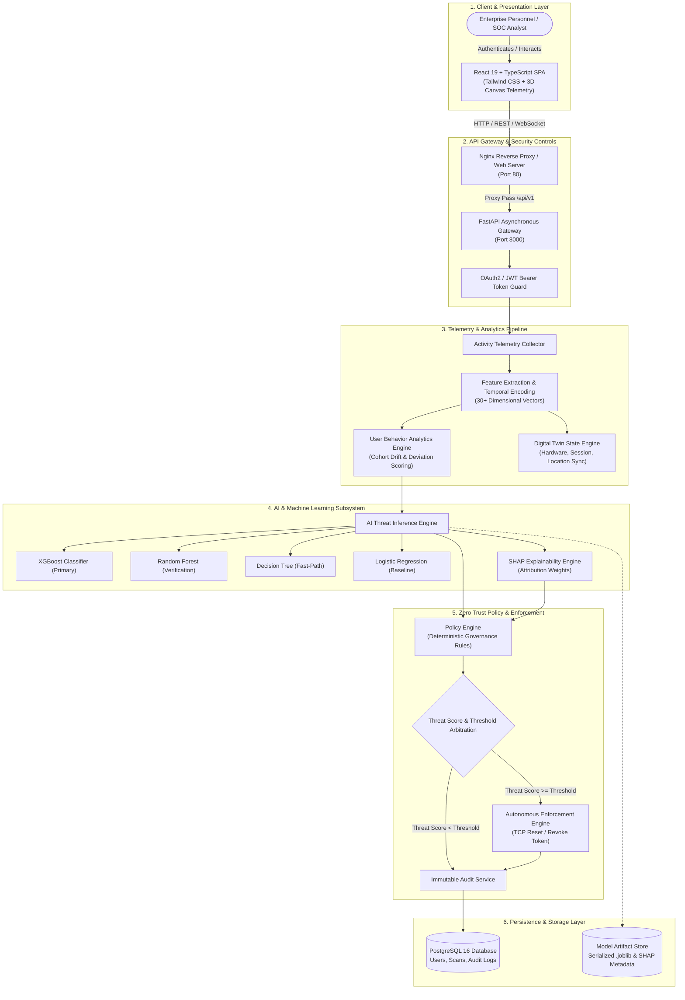

# System Architecture: AI Privacy Firewall

The **AI Privacy Firewall** is designed as an explainable, continuous adaptive security platform capable of detecting unauthorized data access and insider exfiltration using **User Behavior Analytics (UBA)**, **Ensemble Machine Learning**, and **Zero Trust Policy Arbitration**.

---

## 1. Architectural Philosophy

Traditional perimeter firewalls (L3/L4 packet inspection and L7 WAFs) examine external ingress traffic. However, they possess zero visibility into the behavioral nuances of authenticated employees operating within legitimate enterprise permissions.

The AI Privacy Firewall operates on four foundational pillars:
1. **Zero Trust Continuous Verification:** Every request is authenticated, authorized, and behaviorally scored regardless of network location.
2. **Behavioral Baselining (UBA):** Personnel actions are constantly benchmarked against their historical baseline and departmental cohort.
3. **Multi-Model Consensus:** Threat classification utilizes an ensemble of supervised learning architectures (XGBoost, Random Forest, Decision Tree, Logistic Regression).
4. **Explainable AI (XAI):** Decisions provide mathematically rigorous SHAP feature attributions so SOC analysts can audit *why* an action was flagged.

---

## 2. High-Level Architecture Diagram

---

## 3. End-to-End Processing Lifecycle

1. **Request Ingestion:** The client executes an API access request (e.g., query customer billing records, clone git repository, export sensitive parquet files).
2. **Context Enrichment:** The gateway extracts subject identity, request URI, HTTP payload size, client IP, physical device fingerprint, active VPN tunnel status, and timestamp.
3. **Temporal Feature Extraction:** The feature pipeline derives 30+ dynamic behavioral features:
   - `off_hours_access_flag`: Deviation from employee's historical login hours.
   - `download_velocity_bytes`: Rate of data transfer per second.
   - `removable_usb_attached`: Kernel state detection of mass storage peripherals.
   - `vpn_split_tunnel`: Concurrency of direct IP packets alongside corporate WireGuard tunnels.
   - `http_request_frequency`: Request rate per minute.
4. **Cohort Baseline Benchmarking:** The UBA engine evaluates derived features against the subject's 30-day rolling baseline and department peers.
5. **Model Inference:** The vectorized features are passed into the production **XGBoost** classifier (supported by Random Forest consensus). The model yields:
   - Continuous Threat Probability Score ($P \in [0.0, 1.0]$)
   - Binary Classification ($\text{Normal} = 0$, $\text{Threat} = 1$)
6. **Explainability Attribution:** SHAP (SHapley Additive exPlanations) computes the exact contribution of each feature to the resulting threat score.
7. **Policy Arbitration:** The Policy Engine maps the threat score to deterministic security rules:
   - **Threat Score $\ge 0.75$:** `BLOCK` (Immediate TCP RST, HTTP 403 Forbidden, session token revocation).
   - **$0.40 \le$ Threat Score $< 0.75$:** `WARN` (Step-up hardware FIDO2 MFA challenge logged).
   - **Threat Score $< 0.40$:** `ALLOW` (Zero Trust verified access granted).
8. **Audit Logging & Telemetry Broadcasting:** The event, actor, device fingerprint, decision, and SHAP report are persisted into the immutable PostgreSQL audit table and broadcast to the Live Monitoring SOC dashboard.

---

## 4. Subsystem Deep-Dive

### 4.1 Machine Learning Subsystem
Trained on the **CMU CERT Insider Threat Dataset r4.2**, the ML pipeline balances extreme real-world class imbalance using stratified sampling.

| Model Architecture | Test Accuracy | Precision | Recall | F1-Score | ROC-AUC | Inference SLA | Production Role |
| :--- | :---: | :---: | :---: | :---: | :---: | :---: | :--- |
| **XGBoost** | **99.32%** | **99.09%** | **99.32%** | **0.991** | **0.978** | **1.62 ms** | **Active Primary Classifier** |
| **Random Forest** | 99.32% | 99.18% | 99.32% | 0.992 | 0.931 | 1.30 ms | Verification Ensemble |
| **Decision Tree** | 99.28% | 99.32% | 99.28% | 0.993 | 0.763 | 1.28 ms | Fast-Path Fallback |
| **Logistic Regression**| 99.32% | 98.65% | 99.32% | 0.990 | 0.972 | 1.40 ms | Linear Baseline Benchmark |

### 4.2 Digital Twin State Engine
The Digital Twin maintains an in-memory and persistent state of each employee's hardware endpoint, current active session, primary subnet, physical location, and behavioral risk rating. This allows security teams to simulate what-if scenarios (e.g., "What happens if Ram Rajurkar attempts a 50GB database export over split-tunnel VPN at 2:00 AM?").

### 4.3 Zero Trust Policy Engine
Decisions are never purely opaque model outputs. The Policy Engine executes a deterministic rule matrix overriding or reinforcing AI recommendations to ensure strict regulatory compliance (GDPR, HIPAA, SOC 2, ISO 27001).
